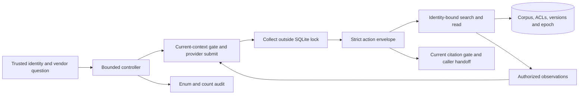

# Architecture and ordering contract

Python 3.11's standard library and bundled SQLite implement this small read-only workflow. The actor exposes two fictional connectors and four scalar topics. There is no framework, vector database, production identity service or arbitrary filesystem/shell tool.

`domain.py` defines request/action/evidence contracts and the authored fact grammar. `providers.py` implements the scripted policy and split adapter. `agent.py` owns the state machine, budgets, repairs and epoch restart. `transport.py` implements an optional loopback Ollama wire adapter. Evaluation code is outside the acting package and is not a registered tool.

## Authorization and linearization

SQLite filters DocsHub object grants and TeamChat channel grants before ranking or returning title/body rows. The bound principal never comes from provider arguments. Search creates random session handles; reads and citation resolution return the same generic `not_available` shape for inaccessible, missing, old or forged references.

Schema version 3 retains the global epoch. SQLite triggers increment it in the same transaction as membership, grant, principal, object or source-version mutations, including trusted raw SQL. A revision replacement installs a new version and advances the current revision atomically. Trusted scenario events are idempotent by event ID; the model cannot invoke them. Owned schema-1/2 stores migrate only after their fixture fingerprint matches. An incompatible store is preserved and rejected. Request/attempt metadata changes do not increment the permission epoch.

A short `BEGIN IMMEDIATE` serializes authorization changes with source-tool release, provider submission and memo handoff. Nested trusted operations join the transaction; audit inserts do not commit it early. Submission includes current-epoch and dependency rechecks, bounded serialization, then the complete request send. The HTTP adapter uses a total two-second connect/header/body budget, a 64 KiB request cap, numeric loopback addresses, and no proxy/redirect route. Collection is outside the transaction and limited to 20 seconds, the remaining run deadline and a 64 KiB response.

After collection, the actor rechecks the epoch and every search/read dependency before parsing or using the response. An epoch change discards the whole outstanding response, observations, handles and both caches. One restart begins from an empty planning context; a second change fails without a partial memo. This is a deliberately coarse global reset for a tiny corpus.

Final citation validation and `MemorySink.release` execute inside the same transaction. The sink receives a defensive memo copy; that caller handoff is the disclosure boundary. A later visual display reads an already released snapshot. If revocation commits first, new private handoff is blocked; if handoff finishes first, later revocation cannot recall it. This contract does not guarantee secure heap erasure or deletion of bytes already sent to a provider. Trusted hooks/observers exist only for deterministic integration checks and must not mutate the transaction's authority.

Seven local permission integration methods passed, including deterministic dispatch/release writer barriers, boundary subcases, source replacement, cache attacks and restart exhaustion. These establish the tested local ordering contract. Main independently accepted M2; these methods also passed within the 128-method M3 full suite.

## Context, caches and output

Every search excerpt remains a dependency, including sources never opened. Evidence cache keys include corpus namespace, principal, epoch, policy version, provider identity, connector, normalized query and limit. Memo keys additionally bind vendor/date. Each of two process-local caches has at most 32 entries and a 60-second TTL; values are copied defensively. Epoch changes purge both, cache lookup reauthorizes source snapshots, and memo reuse reconstructs fresh session handles before the normal guard/handoff. There is no disk memo cache.

The guard requires exactly four unique topics and at most two claims per topic/eight total. Claims must cite opened current authorized evidence, the exact source revision and Python character interval `[start:end]`. Complete authored fact lines must match a typed value. Future evidence is rejected; expired evidence requires `stale_only`; differing current values require `conflict`; unsupported topics remain `unknown`. The controller derives readiness. This grammar is not a general natural-language entailment checker.

The renderer uses accepted values and source-derived citations, never arbitrary provider prose or thinking. A local citation resolver rechecks identity, current revision/epoch and exact quote. There is no external citation URL handler or production connector.

## Bounded execution and failure

States are `CREATED -> PLANNING -> RESEARCHING -> VALIDATING -> COMPLETED | NEEDS_FOLLOW_UP`; cancellation, budget exhaustion and failure are alternate terminals. Epoch invalidation returns once to `PLANNING`. A provider can propose one `revise_plan` in a context. One invalid-action/memo repair is allowed, with only an enum error returned to context.

Limits are 24 decisions, eight search attempts, twelve read attempts, 48 KiB context, 16 KiB decision/memo and a 180-second cooperative deadline. A transient tool-unavailable or SQLite-busy condition gets at most one retry within a one-second tool budget and the global budget; attempts consume counters. Model timeouts are not resent. Cancellation is checked before/after steps; it cannot forcibly preempt an arbitrary hostile in-process provider. The owned HTTP route bounds blocked I/O. Failures clear working references/caches and return an allowlisted code with no partial memo.

## Persistence and outstanding scope

SQLite stores trusted fictional sources, ACLs, versions, fixture fingerprint, epoch, idempotent control events, request bindings, attempt metadata, operational audit and terminal receipts. Audit fields are sequence, UTC time, random run ID, action/status enums, bounded item count and epoch. Receipts hold identity, outcome and decision/search/read counts. Bindings hold a key hash, identity, normalized request hash and policy version. Attempt metadata adds random attempt ID, binding hash, status/timestamps, starting epoch, schema version and three bounded counters. Raw keys, request text, prompts, responses, source IDs/titles, snippets, claims and memo text are absent from these operational tables. The privileged corpus itself intentionally contains restricted text.

The trusted CLI accepts an optional 1-64 character ASCII request key. The binding compares identity, normalized vendor (case/whitespace), request date/four-topic scope and policy version. Reuse with changed binding fails before recovery or provider dispatch. Valid reuse always creates a new random attempt ID, clears warm caches and researches afresh for CLI and API callers; completed receipts contain no memo to replay. Distinct request keys can reuse an ordinary in-process memo only after current-epoch/dependency authorization. The default key is newly generated for each invocation. Key binding detects payload collisions; it does not promise exactly-once research or inference.

`attempts.py` owns a nonblocking local OS file lock for disk stores and a local mutex for an in-memory store. Only one actor attempt can run per database. The lock spans inference but is separate from SQLite; trusted ACL/version writers remain able to commit during collection. The constant lock file is retained to avoid creating two lock identities through unlinking. Windows uses `msvcrt.locking`; POSIX uses `fcntl.flock`. Local Windows cross-process contention and abrupt-exit recovery passed; POSIX execution remains untested. This targets local filesystems, with no distributed lease or production identity claim.

After exclusive ownership is acquired, any remaining `running` attempt has no live owner under this contract. One SQLite transaction classifies it `interrupted`, records an immutable terminal receipt with its last committed counters, and creates the new metadata-only attempt. Current epoch and current source permissions apply to the new run; its observations, handles and caches start fresh after recovery. There is no persisted prompt/memo/context recovery. Counters checkpoint with committed action boundaries, so a crash inside an uncommitted send transaction may omit that attempted send from the old metadata. Model requests may already have reached a provider before a timeout/crash.

SQLite triggers prohibit changing/deleting terminal attempts, receipts or bindings; active attempt identity/version/start metadata and counters are protected from rewriting/decreasing. Normal completion/failure/cancellation finalizes the attempt and inserts its receipt atomically. An actor object is single-use. A live owner rejects competing calls as `attempt_in_progress` without falsely classifying its attempt interrupted. SQLite journals and Python heap references are not secure-erasure mechanisms.

## Evidence limits

M1's doctor, demos and 20 tests were independently accepted. M2 candidate3 passed 80 tests, including race threads, actual HTTP, owned-process/CLI restart checks and full workflows. The independent inspector computes ACLs from raw SQL and checks protected IDs/titles/full bodies/unique lines in provider requests, tool outputs, cache retrieval, memo handoff and citation resolution, plus operational audit/receipt/binding/attempt tables. Shared visible lines are not treated as secret; this is a finite authored-corpus leakage check, not a semantic information-flow proof.

The 12 development labels score final states, typed values, accessible revisions/spans and coverage independently of production guards. The simple baseline shares grammar/guards and reads top-one per connector without follow-up retrieval. Final scripted results were 12/12 versus baseline 9/12, with 29/29 versus 25/25 valid citations and zero detected violations across 351 versus 193 instrumented surface observations, plus separate operational scans. Main independently accepted M2 candidate3 after 14 commands, 80 tests and 502 raw checks. Trusted local identity, tiny English fixtures and a hostile local administrator/provider are explicit limits.

## M3 evaluation boundary

M3 adds evaluation components without changing the accepted actor or baseline. Ten frozen source families and 30 separately authored rubrics live outside registered tools. `evaluation/oracle.py` imports no production code and reads immutable SQL snapshots and authored semantic relationships. `evaluation/heldout.py` owns trusted once-only scenario hooks, fresh per-case stores, cache warm-ups, cross-identity probes and paired repetitions. It invokes the unchanged actor; no fixture, scenario ID or label is placed in provider context.

Candidate3 adds a shared authority gate for every evaluated policy and `evaluation/ledger.py`, which imports no actor/provider/oracle. The ledger reserves new report/sidecar evidence, persists all planned identities and denominators before execution, and flushes each start/completed metrics row. A case exception preserves the observed prefix and exact failed identity/type, marks the batch incomplete/nonpassing and exits nonzero. The closed ledger schema excludes source/context/memo bodies and exception text. Existing evidence is refused rather than overwritten. Baseline domain/task failures remain comparison results; baseline authority failures cannot pass the common gate.

Observer inspection applies independent permissions at each delivery, including rendered/returned results and operational rows. Retained cache entries are checked under their bound identity and epoch; invalidation checks empty caches/context separately from authorized earlier captures. The metrics report exact numerator/denominator and N/A, cost/timing, paired differences and domain-repeat variation. Local Windows M3 integration passed the full 128-method suite, all 180 planned primary attempts, oracle/disclosure corruption controls and clean-copy commands. Scripted passed 90/90 and baseline 78/90, with both passing the common authority gate; all 39 frozen files remain unchanged. Main's independent final acceptance is pending. Hosted CI, POSIX execution and live models remain unexecuted. See [evaluation method](evaluation-method.md), [all 30 rubrics](m3-rubrics.md), [EVIDENCE](../EVIDENCE.md) and [threat model](threat-model.md).
